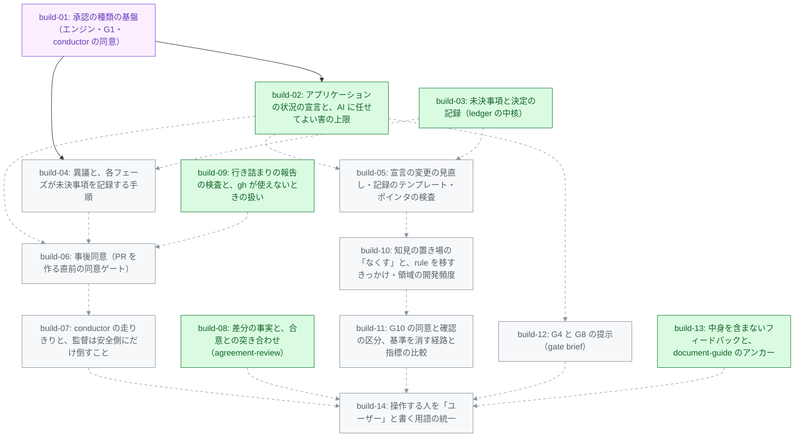

# ビルド一覧 — 001-v3-core-concepts

ビルドの完了判定は `PR` 列が非空かどうかで行います。
`PR` 列の更新は当該ビルドの PR に同梱されるため、デフォルトブランチ上で
`PR` 列が埋まっていること自体がマージ済みを意味します。

依存関係のあるビルドは、先行ビルドがデフォルトブランチにマージ済みであることが必須です。
依存関係がないビルドは並行実行できます。

| buildID | title                                                           | 予測ピーク | dependencies                              | PR                                                     |
| ------- | --------------------------------------------------------------- | ---------- | ----------------------------------------- | ------------------------------------------------------ |
| 1       | 承認の種類の基盤（エンジン・G1・conductor の同意）              | 360k       | —                                         | [#109](https://github.com/tak-solder/hikyaku/pull/109) |
| 2       | アプリケーションの状況の宣言と、AI に任せてよい害の上限         | 350k       | 1                                         | —                                                      |
| 3       | 未決事項と決定の記録（ledger の中核）                           | 355k       | —                                         | —                                                      |
| 4       | 異議と、各フェーズが未決事項を記録する手順                      | 365k       | 1, 3                                      | —                                                      |
| 5       | 宣言の変更の見直し・記録のテンプレート・ポインタの検査          | 330k       | 2, 3                                      | —                                                      |
| 6       | 事後同意（PR を作る直前の同意ゲート）                           | 395k       | 2, 4, 9                                   | —                                                      |
| 7       | conductor の走りきりと、監督は安全側にだけ倒すこと              | 395k       | 6, 9                                      | —                                                      |
| 8       | 差分の事実と、合意との突き合わせ（agreement-review）            | 360k       | —                                         | —                                                      |
| 9       | 行き詰まりの報告の検査と、gh が使えないときの扱い               | 305k       | —                                         | —                                                      |
| 10      | 知見の置き場の「なくす」と、rule を移すきっかけ・領域の開発頻度 | 345k       | 5                                         | —                                                      |
| 11      | G10 の同意と確認の区分、基準を消す経路と指標の比較              | 340k       | 1, 3, 10                                  | —                                                      |
| 12      | G4 と G8 の提示（gate brief）                                   | 280k       | 2                                         | —                                                      |
| 13      | 中身を含まないフィードバックと、document-guide のアンカー       | 295k       | —                                         | —                                                      |
| 14      | 操作する人を「ユーザー」と書く用語の統一                        | 275k       | 1, 2, 3, 4, 5, 6, 7, 8, 9, 10, 11, 12, 13 | —                                                      |

## 依存グラフ

紫: 完了（merged） / 緑: 着手可能（ready） / グレー: 待機中（blocked）。点線は先行ビルドが未完了の依存
