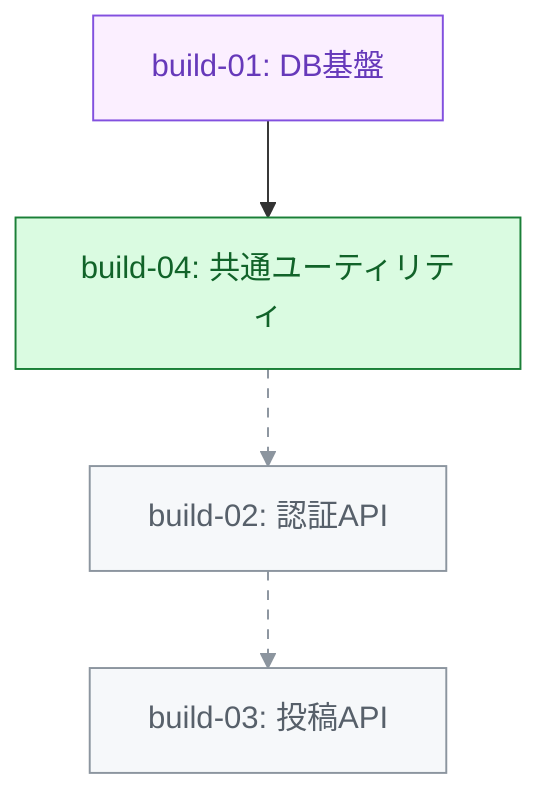

# ビルド管理 テンプレート集

## tasklist.md

`tasklist.md` の生成・更新はスクリプトが行います。手で書き換えず、
`hikyaku tasklist add / update / done` を使ってください（依存グラフの再生成と
循環依存の検証が同時に行われます）。

````markdown
# ビルド一覧 — 002-billing

`PR` 列の更新は当該ビルドの PR に同梱されるため、`HEAD` で `PR` 列が
埋まっていること自体が「その実装がこのブランチの履歴に在る」ことを意味します。
デフォルトブランチ上で埋まっていれば「マージ済み」を意味します。

依存関係のあるビルドは、先行ビルドの成果がこのブランチの履歴に在ることが着手の条件です。
先行ビルドがマージされていても、そのブランチから積んで（スタックして）いても構いません。
依存関係がないビルドは並行実行できます。

| buildID | title              | 予測ピーク | dependencies | issue                        | PR         |
| ------- | ------------------ | ---------- | ------------ | ---------------------------- | ---------- |
| 1       | DB基盤             | 320k       | —            | [issue](./build-01/issue.md) | pr/10      |
| 2       | 認証API            | 410k       | 1, 4         | [issue](./build-02/issue.md) | —          |
| 3       | 投稿API            | 380k       | 2            | [issue](./build-03/issue.md) | —          |
| 4       | 共通ユーティリティ | 300k       | 1            | [issue](./build-04/issue.md) | —          |

## 依存グラフ



紫: 完了（merged） / 緑: 着手可能（ready） / グレー: 待機中（blocked）。点線は先行ビルドが未完了の依存
````

**カラム説明:**

| 列 | 意味 |
|---|---|
| `buildID` | 作成順の連番。`max(既存) + 1` で採番し、リナンバリングは行わない |
| `title` | ビルド名 |
| `予測ピーク` | architect 段階で見積もった、メインセッションのコンテキストのピーク（`hikyaku tokens estimate` の算出値。手順は [estimate.md](estimate.md)） |
| `dependencies` | 直接の依存ビルドID。実行順序はこの依存グラフで決まる。グラフは推移的簡約で描かれるため、経由して到達できる依存（例の build-02 の依存 build-01）は線として現れない |
| `issue` | `build-{NN}/issue.md` への相対リンク。作成時に記録し以後不変 |
| `PR` | **着手可否と完了判定に使う唯一の列**。当該ビルドの PR に同梱して更新する |

**`PR` 列を先にデフォルトブランチへ入れてはいけません。** 実装が入っていないツリーで
`PR` 列だけが埋まった状態になり、「成果がこのツリーに在る」という意味が壊れます。
`hikyaku tasklist done` の結果は、必ずそのビルドの PR に含めてください。

**status 列は持ちません。** PR 列の更新が当該ビルドの PR に同梱される以上、
PR 列が埋まっていること自体が状態を表します。status 列を別に持つと
「status は done だが PR 列が空」という嘘の状態が作れてしまいます。

## build-{NN}/issue.md

issue.md の本文は build-manager（LLM）が書きます。tasklist.md の行は
スクリプトが書きます。この分担により、長い Markdown をスクリプトへ渡す必要がなくなります。

```markdown
# Build {NN}: {ビルド名}

## やること

- （スコープ内の作業）

## やらないこと

- （明示的なスコープ外。ここを書かないとスコープが膨らむ）

## 対応する受け入れ基準

- US-1.1, US-1.2（このビルドで満たす user-stories.md の受け入れ基準。基盤整備など直接対応しないビルドは「なし（理由）」）

## 受け入れ基準

- [ ] （完了条件1）
- [ ] （完了条件2）

## 参照する設計ドキュメント

- `design/design-delta.md` の「（節）」
- `constraints` の「（節）」— （このビルドの何を縛るか）
- `decisions` の `{ADR のファイル名}` — （このビルドのどの実装がこの判断に従うか）

## マージ時点で残る危険

（安全でない分割を使ったビルドだけに書く。使っていなければ節ごと書かない）

- （このビルドをマージした時点で、本番に出ると何が壊れうるか）
- 安全な分割にできなかった理由: （例: 安全に分けると予測ピークが split_above を大きく超える）
- 解消するビルド: build-NN（このビルドに依存させる）

## 予測ピーク

（`hikyaku tokens estimate {cycle} ... --markdown` の内訳表をそのまま貼る。
　成分の根拠として、読むファイルと作成するファイルを列挙する）

読むファイル: （例: `design/design-delta.md` の「請求」、`src/billing/*.ts`（8ファイル）, ...）
作成するファイル: （例: `src/billing/invoice.ts`, `src/billing/invoice.test.ts`, ...）

| 成分 | 予測 | 根拠 |
|------|------|------|
| ... | ... | ... |

（split_above を超えたまま1ビルドにした場合だけ、その理由を書く）
```

「参照する設計ドキュメント」は、builder が読む永続ドキュメントの範囲を決める。builder は
`overview` / `decisions` / `constraints` の全文を読まず、ここが指す節だけを読む
（`conventions` は、AGENTS.md に無ければ `hikyaku context` が builder に渡すので、ここで指さなくても読まれる）。本文は写さず、
論理名と節（ADR はファイル名）で指し、このビルドに関係する理由を一言添える。写すと、設計から
実装までの間に永続ドキュメントが変わったとき、古い写しが残る。該当する節が無ければ
「永続ドキュメント: なし」と書く（選んだ結果として無いことを残す）。

「予測ピーク」の表は build-manager が `tokens estimate` の出力を貼るもので、手で計算しません。
表の最後の行は見積もりに使ったガイドの版で、消しません。builder は plan.md で成分を見直して
見積もり直すので、ここに書くのは architect 段階の予測です。

「対応する受け入れ基準」の見出しは変えません。`hikyaku validate` がこの見出しの節から番号を読み、
user-stories.md の受け入れ基準がどれかのビルドに割り当てられているかを検査します。
「受け入れ基準」はビルドの完了条件で、user-stories.md の受け入れ基準を実装の言葉に
落としたものです。番号を参照するのは「対応する受け入れ基準」の側だけにします。
